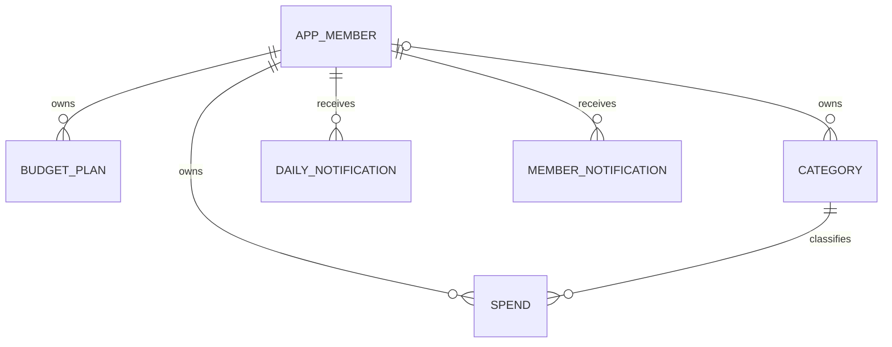

# ERD 및 테이블 정의

> 새 알림은 V3의 MEMBER_NOTIFICATION을 사용한다. DAILY_NOTIFICATION 및 notification_seq는 V1 이력과 기존 데이터 보존을 위해 남아 있다. 기존 PNG는 V1 기준이며 아래 정의가 최신이다.

Oracle Free / 애플리케이션 스키마 BUDGET_APP / 서비스 FREEPDB1. 영문 테이블/칼럼, 문자열은 VARCHAR2(... CHAR), 금액 NUMBER(14,0). ORM 자동 생성 대신 Flyway 버전 SQL을 기준으로 한다. PK는 테이블별 Oracle sequence, allocationSize=1. 기록 시각은 한국시간 TIMESTAMP.

| 테이블 | 칼럼: 타입 | 제약/의미 |
|---|---|---|
| APP_MEMBER | id NUMBER(19), email VARCHAR2(254), password_hash VARCHAR2(100), name VARCHAR2(50), created_at TIMESTAMP | PK id, UNIQUE email, 모두 필수 |
| BUDGET_PLAN | id NUMBER(19), member_id NUMBER(19), ym VARCHAR2(7), amount NUMBER(14), created_at/updated_at TIMESTAMP | 회원 FK, UNIQUE(member_id,ym), 양의 금액, 월 문자열 |
| CATEGORY | id NUMBER(19), member_id NUMBER(19) NULL, name VARCHAR2(50), normalized_name VARCHAR2(50), active NUMBER(1), created_at/updated_at TIMESTAMP | 회원 FK, NULL 소유자는 공용. UNIQUE(NVL(member_id,0),normalized_name), 활성 0/1 |
| SPEND | id NUMBER(19), member_id NUMBER(19), spend_date DATE, category_id NUMBER(19), amount NUMBER(14), memo VARCHAR2(200) NULL, created_at/updated_at TIMESTAMP | 회원/카테고리 FK, 양의 금액, 인덱스(member_id,spend_date) |
| DAILY_NOTIFICATION | id NUMBER(19), member_id NUMBER(19), notice_date DATE, opening_amount NUMBER(19), read_at TIMESTAMP NULL, created_at TIMESTAMP | 회원 FK, UNIQUE(member_id,notice_date), 음수 금액 허용 |
| MEMBER_NOTIFICATION | id NUMBER(19), member_id NUMBER(19), notice_date DATE, remaining_amount NUMBER(19) NULL, read_at TIMESTAMP NULL, created_at TIMESTAMP | 회원 FK, UNIQUE(member_id,notice_date), 음수 허용, 금액 NULL은 예산 미설정 |

V2의 BATCH_* 6개 테이블과 3개 시퀀스는 Spring Batch 실행 상태·파라미터·chunk 재시작 위치를 저장한다. 알림 데이터와 역할이 다르다.

PK/FK 및 nullable 표기 외 값은 필수. 비밀번호 원문·KIS 키·OAuth 토큰 저장 없음. 카테고리 normalized_name은 서버에서 trim/lowercase 정규화하여 저장. 월은 값 변환 없이 명확한 문자열로 저장한다. 지출은 예산 미설정 상태에서도 기록 가능하며 예산 FK는 두지 않는다. 타인 카테고리 이용은 서비스가 검증한다.

DDL 변경은 이미 실행한 V1 수정 대신 V2 이후 새 마이그레이션으로 추가한다. Toad에서 임의 운영 DDL을 실행하지 않는다. 정확한 SQL은 src/main/resources/db/migration을 참조한다.
