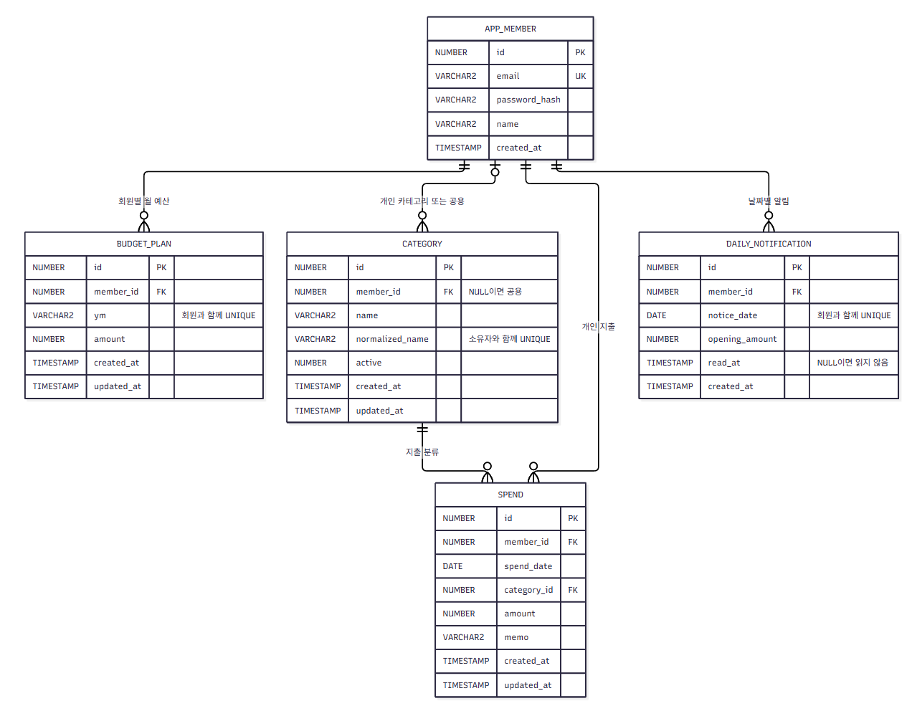
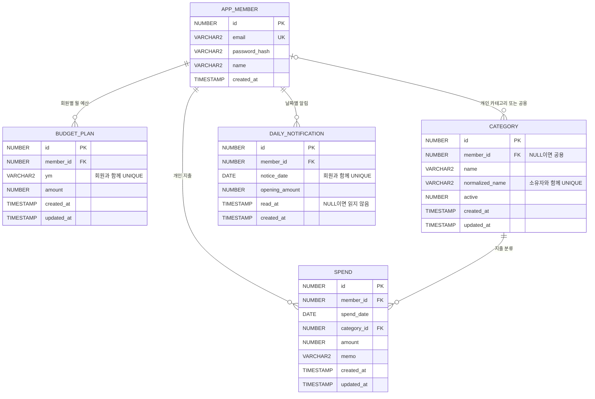

# ERD

> 기존 알림 기능은 제거했지만 DAILY_NOTIFICATION 및 notification_seq는 적용된 V1 이력과 기존 데이터 보존을 위해 남아 있다. 아래 ERD는 보존된 물리 스키마도 포함한다.

관계 정의와 상세 칼럼은 [테이블 정의서](05-database.md)와 [실제 Oracle DDL](../src/main/resources/db/migration/V1__budget_schema.sql)을 함께 확인한다.

지출과 월 예산은 회원·월로 조회 시 연결하지만 직접 FK를 두지 않는다. 예산 미설정 상태에서도 지출을 기록할 수 있기 때문이다. 카테고리 소유권은 서비스에서 검증하며 비활성화가 기존 지출을 삭제하지 않는다. 회원 탈퇴/전체 기록 삭제는 이번 기능 범위에 없다.
